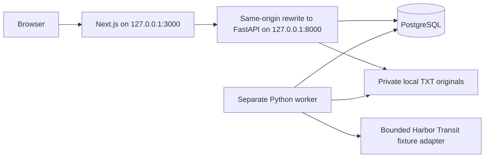

# Architecture of the implemented text/fixture slice

This document describes the current code. The larger portfolio plan remains proposed work beyond this slice.

## Persistence and execution

`collections` owns `documents`, immutable extracted `passages`, `investigations`, `findings`, `review_events`, `jobs`, and ordered `job_events`. Composite foreign keys reject cross-collection passage/finding associations. The runtime chooses the local owner; client requests cannot select one.

Uploads stream a raw text body under a 2 MiB cap. Text must decode as UTF-8, be nonempty, contain no null bytes, and remain under 500,000 characters. Original bytes receive random private storage keys and SHA-256 checksums, verified by the worker before extraction. Byte-identical duplicates in a collection are rejected. Each document has at most 5,000 bounded passages; extracted-text offsets and line mappings are retained. There is no PDF parser or embedding operation in this build.

The worker claims queued or expired running jobs using `FOR UPDATE SKIP LOCKED` in a short transaction. It processes outside that lock and publishes in a transaction guarded by its unique lease token, lease expiry, source state, and collection revision. Work is at least once, not exactly once. Fixture/text jobs are deliberately short and do not renew leases yet. Retries are limited to three claims and a 180-second window from creation. Deterministic fixture/validation failures are terminal.

Publication, review, deletion, and cancellation use collection-first locking, followed by job/run locks, to serialize consequential state changes. A stale worker cannot publish after another attempt takes its lease. Cancellation prevents publication. Source deletion tombstones first, invalidates old investigations, and queues physical/content cleanup. Cleanup cannot be cancelled.

## Evidence and review

The fixture adapter only accepts checksummed original synthetic reports and three exact case-insensitive claim scenarios. It selects known source passages, returning exact offsets and predefined interpretations. The worker validates passage scope and quote equality before any finding is published. This verifies citation mechanics; it does not demonstrate real semantic retrieval, extraction, or model quality.

Reviews preserve immutable fixture interpretations while storing decision/note changes and append-only review events. Optimistic revisions reject stale updates. Investigations retain their original claim, source checksum manifest, excluded source list, and analysis version. Changed source collections make prior investigations stale.

Markdown exports are generated synchronously under the source/review lock, using an expected review revision. Accepted evidence is included by default; drafts explicitly include unreviewed evidence and carry a draft label. Citations contain exact excerpts, line references, local links, source hashes, run identifiers, and review provenance. No stored export artifact exists yet.

## Decisions

- **Local scope:** one installation principal, no signup/account system or public hosting.
- **One repository, cohesive modules:** one frontend, API, and worker; no microservice split.
- **PostgreSQL first:** database-backed jobs and real persistence; no SQLite substitute. pgvector belongs to the live retrieval milestone.
- **Fixture first:** validate the application workflow without keys while labeling its limited AI coverage everywhere.
- **Streaming raw text upload:** a small contract change from proposed multipart to cap bytes before spooling. PDF ingestion is deferred.
- **On-demand Markdown:** bounded generation from a locked snapshot; persistent exports/version management belong to later milestones.
- **Separate UI and API:** Next.js presents and proxies; FastAPI owns policy, validation, persistence, and evidence logic.

## Future acceptance work

PDF versions/pages and restricted parser execution; source replacement/reprocessing generations; embedding profile/index lifecycle; measured keyword/vector retrieval; generation/embedding capability adapters; provider deadlines and renewed job leases; evaluation baselines and held-out thresholds; stored export revisions; performance measurements; and hosted identity only if separately requested.

Component choices were checked against [FastAPI](https://fastapi.tiangolo.com/tutorial/background-tasks/), [PostgreSQL locking](https://www.postgresql.org/docs/current/sql-select.html), [SQLAlchemy PostgreSQL support](https://docs.sqlalchemy.org/en/20/dialects/postgresql.html), and [Next.js rewrites](https://nextjs.org/docs/app/api-reference/config/next-config-js/rewrites). These references describe component behavior, not application verification.
