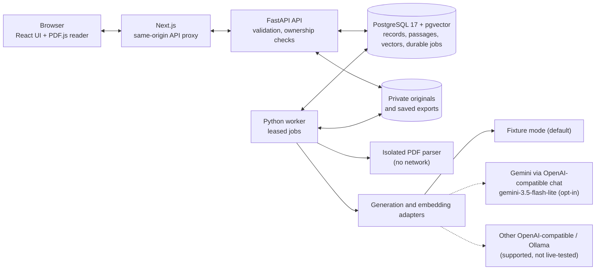
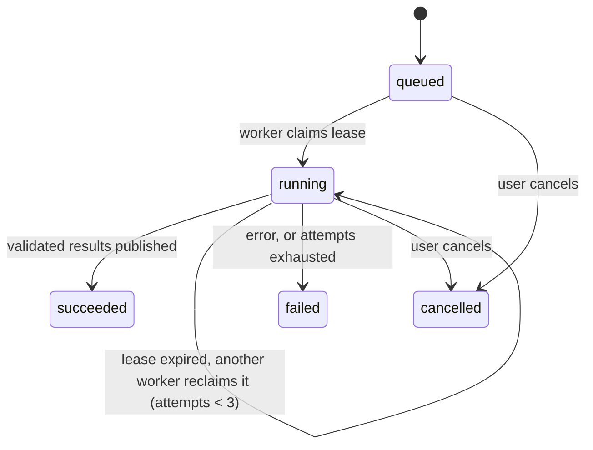

# EvidenceLens architecture

EvidenceLens is a private local installation: Next.js UI → FastAPI API → PostgreSQL 17/pgvector and a private artifact directory. A separate Python worker claims durable PostgreSQL jobs. Docker Compose also provides a complete local runtime. There is no Redis, hosted identity, crawling, or autonomous external action.

## Data and ownership

Collections have a server-assigned local owner. Every record-ID API checks the owning collection; composite database relationships constrain evidence to its collection and source. This boundary supports future accounts but does not authenticate people on a shared machine.

Document rows are immutable versions grouped by family ID; only one nondeleted version is active. Original bytes have SHA-256 hashes and random private storage keys. Page passages retain text offsets, page numbers, and line references. A replacement or active-version change increments the collection revision and invalidates previous analyses/exports. Retained versions stay readable until their family is deleted.

Claims and claim revisions persist independently of investigations. Investigations pin the claim revision, source manifest, collection revision, adapter configuration, embedding profile, and analysis version. Findings require an in-context passage ID and exact quotation. Reviews use optimistic revisions and append review events.

## Ingestion and parsing

Upload requests stream into a capped buffer with a 60-second receive deadline, validate type/size, and persist the original and ingestion job. PDF extraction runs outside API/worker logic. macOS uses a network-disabled, read-only parser container with a single read-only input mount and CPU/memory/process limits. Linux uses an isolated Python subprocess with a secret-free environment and OS CPU/address-space/file limits; app containers add outer filesystem, capability, memory, and process restrictions.

The parser emits text per physical page and extraction warnings. Encrypted, malformed, empty/scanned, over-page, over-text, resource-exhausted, and timed-out files produce recoverable job errors. Extracted text is chunked within page boundaries at at most 3,000 characters per passage. Embeddings are validated before passages/index rows publish in one transaction.

Linux subprocess isolation limits resources and inherited secrets; it is not a separate network namespace. The macOS parser and full Docker app paths were exercised. Arbitrary parser exploitation is not proven impossible.

## Retrieval and models

Embedding profiles fingerprint provider, endpoint, model, dimensions, distance, and chunking version. Vectors from different profiles never mix. An explicit reindex job atomically publishes the requested generation while old profiles remain traceable. An investigation fails with an actionable index/configuration error rather than using an incompatible index.

Retrieval scopes both vector and keyword queries to the pinned collection/source set. Exact cosine search and PostgreSQL full-text matching each return at most 40 candidates; reciprocal-rank fusion selects at most 12 passages, with at most three per source and a conservative byte-based context cap. Exact search suits v1's bounded local corpus; approximate indexing is not claimed. Retrieval hits and context membership persist for inspection.

Generation adapters cover OpenAI Responses, strict-schema compatible chat, and Ollama chat. Embedding adapters are separate. Model text cannot invoke tools. Deterministic validation rejects wrong IDs, invented quotes, inconsistent evidence/outcome combinations, bad dimensions, nonfinite vectors, refusals, and incomplete responses. One schema/evidence repair is allowed. HTTP requests have response caps, timeout, bounded retries, no redirect following, and no environment-proxy inheritance.

Live generation was exercised only with `gemini-3.5-flash-lite` on synthetic samples (see [live validation](live-validation.md)); no live model is accepted as quality-validated. Fixture mode uses hashed lexical demo vectors and predefined Harbor interpretations; it deliberately refuses arbitrary-document analysis.

## Durable jobs

Jobs include ingestion, investigation, reindex, claim suggestions, provider checks, exports, and deletion. Claiming uses row locks with SKIP LOCKED, renewed leases, fencing tokens, a maximum of three attempts, persisted stages, first-start deadlines, cancellation, and bounded provider-call budgets across retries. Publication rechecks the lease and collection/source state. Unexpected crashes leave leased work for recovery rather than silently losing it.

Export creation locks and validates a specific review revision, stores a frozen snapshot, and queues Markdown rendering. Downloads verify the artifact checksum, source validity, ownership, and export state. Later review changes do not rewrite an existing snapshot; source changes invalidate download access. The old direct Markdown route remains deprecated for compatibility.

Deletion first tombstones records, cancels affected jobs, and invalidates exports. Cleanup removes originals, vectors, passages, source-dependent findings/reviews, suggestions, retrieval traces, and export snapshots/artifacts. Collection deletion also clears analyst claims/revisions. Expired orphan files and parser directories are swept. Cleanup failures remain inspectable/retryable. Database tombstones, hashes, configuration, and numeric operational metadata can remain; downloaded files and backups require separate retention.

## Frontend and deployment

OpenAPI generates frontend response types. PDF.js uses same-origin worker/fonts/maps, page controls, bounded canvas/image sizes, disabled XFA/Wasm, and text-only extracted citations. React never inserts document/model HTML. Completed jobs stop frequent polling; idle refresh and tab visibility/focus keep the reading room current.

Docker uses pinned base-image digests, an external database volume, a shared private artifact bind mount, unprivileged application users, read-only app filesystems, and loopback published ports. The database initializer installs vector as administrator; the app role owns only its databases. Production hosting would require a separate identity, network, secrets, backup, and runtime-role design.

## Architecture decisions

| # | Decision | Why | Trade-off |
| - | --- | --- | --- |
| 1 | Findings must cite an in-context passage ID and an exact quotation, checked in code before publishing | A model cannot invent evidence; every claim in a brief opens the cited passage | Valid but paraphrased model output is rejected (one repair attempt is allowed) |
| 2 | PostgreSQL is both the vector store (pgvector) and the job queue | One service to run locally; jobs, vectors and records commit in the same transactions | Exact vector search only; fine for a bounded local corpus, not large ones |
| 3 | Hybrid retrieval: vector + full-text, fused by reciprocal rank, at most 12 passages and 3 per source | Keyword search catches exact figures and names that embeddings miss; per-source caps keep contradicting sources in context | Context can still omit a relevant passage (the 2/3 context-quote result) |
| 4 | Durable leased jobs with fencing tokens and at most three attempts | A crashed worker cannot publish stale results, and work is not silently lost | More moving parts than a simple background task |
| 5 | PDF parsing in an isolated parser (network-disabled container on macOS, resource-limited subprocess on Linux) | PDFs are untrusted input; parser bugs should not reach the API or secrets | Slower ingestion; Linux subprocess has no network namespace |
| 6 | Immutable document versions; any source change bumps the collection revision and invalidates analyses and exports | A brief always matches the exact sources it cites | Re-running analysis after every source change |
| 7 | Embedding profiles fingerprint provider, model, dimensions and chunking; explicit reindex | Vectors from different models never mix silently | Changing embedding settings requires a reindex |
| 8 | Exports freeze a reviewed snapshot and are checksum-verified on download | Later edits cannot change a brief that was already exported | Snapshots take storage until deleted |
| 9 | Fixture mode with lexical demo vectors by default; Gemini and other providers opt-in | Runs fully offline and deterministically for tests and first-time users | Fixture mode refuses arbitrary documents |
| 10 | Next.js same-origin proxy in front of FastAPI | No CORS, and the API is never exposed directly to the browser | Extra hop in development |
